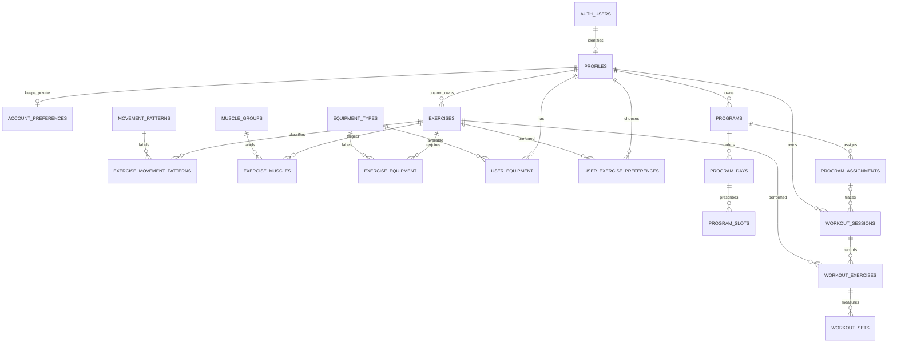

# Phase 2.1 database schema

Phase 2.1 is merged into main; its hosted deployment status was not queried. Phase 2.2 adds a new local-only forward security migration without changing the initial migration. Application clients/UI are unchanged. See [the current authorization matrix and policy reference](database-security.md).

Migration: `supabase/migrations/20261103165311_initial_body_schema.sql` (generated with the official pinned Supabase CLI 3.0.0). All SQL is under root `supabase/`, not `src/lib/`. Catalog data and application seeds are intentionally absent.

## Table inventory

All 18 tables are in the exposed `public` schema with RLS enabled. Phase 2.1 revoked every API privilege; Phase 2.2 deliberately adds authenticated owner/catalog policies and narrow column grants. `PUBLIC`, `anon`, and `service_role` remain ungranted. Profiles/preferences and workout data remain private; system catalog reads require a signed-in identity. The exact per-table rules are documented in [database-security.md](database-security.md).

| Table                        | Primary key and relationships                                                 | Purpose                                                                                                                                         |
| ---------------------------- | ----------------------------------------------------------------------------- | ----------------------------------------------------------------------------------------------------------------------------------------------- |
| `profiles`                   | `id` = `auth.users.id`; account deletion cascades                             | Display name and optional avatar only. No date of birth or account credentials. No automatic auth trigger.                                      |
| `account_preferences`        | `owner_id` → profile, one-to-one                                              | Private DOB, onboarding completion timestamp, goal, preferred workout frequency/split, and display weight unit.                                 |
| `movement_patterns`          | UUID `id`, unique `slug`                                                      | Stable movement taxonomy; multiple patterns per exercise.                                                                                       |
| `muscle_groups`              | UUID `id`, unique `slug`                                                      | Normalized muscle taxonomy.                                                                                                                     |
| `equipment_types`            | UUID `id`, unique `slug`                                                      | Equipment taxonomy shared by library and user availability.                                                                                     |
| `exercises`                  | UUID `id`; nullable `owner_id` → profile                                      | System entries have no owner; private custom entries have an owner. Name, description, instructions, archive timestamp.                         |
| `exercise_movement_patterns` | `(exercise_id, movement_pattern_id)`                                          | Many-to-many classification.                                                                                                                    |
| `exercise_muscles`           | `(exercise_id, muscle_group_id)`                                              | Many-to-many muscles with `primary` or `secondary` role. Multiple primary muscles are supported.                                                |
| `exercise_equipment`         | `(exercise_id, equipment_type_id)`                                            | All listed equipment is required. Alternative equipment combinations are deferred.                                                              |
| `user_equipment`             | `(owner_id, equipment_type_id)`                                               | User equipment availability.                                                                                                                    |
| `user_exercise_preferences`  | `(owner_id, exercise_id)`                                                     | Favorite flag, preferred/neutral/avoid preference, private notes.                                                                               |
| `programs`                   | UUID `id`; owner → profile; optional same-owner `derived_from_program_id`     | Original programs and reusable templates; name, description, cycle length, revision, archive timestamp.                                         |
| `program_days`               | UUID `id`; `(program_id, owner_id, cycle_length)` → program                   | Ordered cycle positions, including explicit rest days. Unique `(program_id, cycle_position)`.                                                   |
| `program_slots`              | UUID `id`; `(program_day_id, owner_id)` → day                                 | Ordered movement-pattern and/or selected-exercise slots; target set count, rep range, normalized load, rest, notes.                             |
| `program_assignments`        | UUID `id`; program/owner/cycle → program; cursor → a real program day         | Active/paused/completed/archived assignment, start/end, explicit next cycle position and completed rotations. One active assignment per user.   |
| `workout_sessions`           | UUID `id`; owner → profile; optional consistent source program/day/assignment | Actual session, timestamps, notes, status/completion level, original source attribution and name snapshots. Ad hoc sources may all be NULL.     |
| `workout_exercises`          | UUID `id`; `(workout_session_id, owner_id)` → session                         | Ordered performed/substituted exercises, original prescription identity and snapshot, source slot, prescribed set count/rest, status and notes. |
| `workout_sets`               | UUID `id`; `(workout_exercise_id, owner_id)` → performed exercise             | Ordered warm-up/working/drop/rest-pause sets; independent prescription and actual values, completion status/time, notes and edit timestamp.     |

UUID identifiers are stable references; names are presentation data, never identity. Junction tables have composite keys. Tables with mutable fields have `created_at` and trigger-maintained `updated_at`; append-only classification links have `created_at`.



## Ownership and security

`profiles.id` references Supabase-managed `auth.users` without modifying its schema. Profile creation is explicit; auth/signup automation is deferred. Deleting an account cascades its owned data. Hard deletion of referenced plans and exercises is restricted; archive them instead. Source-slot deletion is exceptional: its nullable provenance FK is cleared while recorded snapshots and sets remain.

All owner columns reference profiles. Composite foreign keys prevent a day from joining another user's program, a slot from joining another user's day, an assignment/session from joining another user's program, an exercise from joining another user's session, and a set from joining another user's performed exercise. Owner columns are immutable. Invoker triggers additionally prevent private custom-exercise references across owners and ensure initial source-slot/day consistency. These are relational integrity rules, not substitutes for RLS.

Phase 2.1's default-deny migration remains immutable. The Phase 2.2 forward migration now enables the reviewed owner operations described in [database-security.md](database-security.md). Policies use verified `auth.uid()`, both UPDATE checks, and parent exercise visibility for custom classification links. Column grants deny mutation of ownership/identity/parent keys and server timestamps. No `SECURITY DEFINER`, public views, broadly readable profiles, or service-role API path was introduced.

The relational pgTAP file keeps its existing invariant/history assertions; current role/grant behavior is independently tested in `security.test.sql`. Legacy blanket-denial assertions were replaced because authenticated owner reads/writes are now intentionally enabled. Profile creation will be explicit after a verified signup session in Phase 3; no auth UI or managed auth trigger was added. Profile/session/performed-exercise deletion remains denied to protect cascading history. Hosted databases are untouched by this phase.

## Important constraints and indexes

- Required names/slugs reject blank input; catalog slugs are unique. Training goals are strength, hypertrophy, or fat loss preserving muscle. Preferred frequency is explicitly workouts per seven days, a preference rather than program scheduling. Split is an extensible nonblank label. Equipment is normalized rather than a JSON list.
- Cycles range from 1–366 positions. Position and ordering values are positive and unique within their parent. The upper limit is an MVP resource bound, not a calendar assumption.
- `cycle_length` is deliberately repeated in day/assignment rows to permit declarative bounds plus a composite FK to the parent. Parent length changes cascade; a shrink that would strand a position/cursor fails. This is controlled redundancy, not an independent editable setting.
- Day rows are editable program drafts; they may initially be sparse. An assignment cursor must point to an existing day. A future activation service must validate/materialize every position before activation; absent draft positions are **not** implicit rest days. Complete contiguous 7-day and 10-day examples are tested.
- Rest days reject slots; days with slots cannot turn into rest. A planned session cannot use a rest day. These invoker triggers lock referenced parent rows while checking them.
- Rep prescriptions are optional ordered min/max pairs. Set counts are positive, weights are nonnegative `numeric(10,3)`, and NaN is rejected. SQL numeric precision bounds reject infinite loads. Completed sets require explicit reps, weight and completion timestamp; skipped sets cannot retain actual measurements. Zero actual reps is allowed for an attempted failed rep, not treated as a PR.
- In-progress sessions have no finish time; completed/abandoned sessions must have one, not earlier than start. A completed session can be none, partial or full after the Phase 5.1 extension (none explicitly means no completed sets); an abandoned/in-progress session can be none or partial. These labels express a logging decision and do not automatically synthesize/complete child sets. The future logging service must maintain its aggregate completion labels transactionally.
- Normalized weights are **kilograms**, with three decimal places. Actual zero load is an explicit recorded value for bodyweight/no added load; unknown load is NULL on incomplete sets. Stored load is external/added load, not total body mass. Display conversion to pounds belongs at the boundary (`kg × 2.2046226218`), with display rounding only. Assistance, machine ratios and unilateral volume conventions are deferred.
- Timestamps use `timestamptz`. User-local calendar grouping needs an explicit user timezone later; cycle progression is independent of calendar weekdays or timezone offsets.
- Owner-leading indexes support future RLS predicates and user-scoped reads. Junction reverse indexes support taxonomy filtering/FK checks. Program days/slots/sets have unique parent-position indexes. Provenance FK indexes support joins/deletion checks. Completed-set history has a partial `(workout_exercise_id, completed_at DESC)` index; performed exercises have an `(owner_id, exercise_id, workout_session_id)` lookup. Session owner/finish indexing supports consistency/history queries. No materialized PR tables are created.

## Rotation examples and progress safety

A seven-position cycle can be Upper, Lower, Rest, Upper, Lower, Rest, Rest. An eight-position cycle can be Upper, Lower, Rest, Upper, Lower, Rest, Conditioning, Rest. A ten-position cycle can be Push, Pull, Legs, Rest, Upper, Lower, Conditioning, Push, Pull, Rest. These are illustrations in documentation, not seeded product programs.

`program_days.cycle_position` is 1-based. `program_assignments.next_cycle_position` points to the next **explicit day**, including rest, and `completed_rotations` distinguishes repeated laps. A rest position is acknowledged without manufacturing a workout session. Wrapping position 10 to 1 increments completed rotations in the same future transactional operation.

There is intentionally no trigger that advances the cursor on session insertion, completion, abandonment, deletion, or historical correction. A partial or abandoned session can therefore be recorded without silently consuming a scheduled day. Source position/rotation remain on the session to distinguish attempts. Future progression code must define the user's explicit choices (retry, skip, acknowledge rest, advance), lock the assignment or use compare-and-swap, update cursor/lap together, and provide idempotency/audit behavior. That scheduling service and its API are not implemented here. Tests verify completing a partial session and recording an abandoned one leave the cursor unchanged and that rest/wrap changes require explicit updates.

`program_assignments` separates reusable templates from a user's current activation. MVP ownership is same-user throughout. Future trainer-to-client access will require an explicit authorization relationship and a reviewed migration relaxing the relevant ownership FKs; it must not be enabled by allowing arbitrary cross-user references now.

## Historical preservation and safe correction

Plans are mutable prescriptions; sessions/exercises/sets are separately owned facts. At creation, the future logging service must copy the selected plan/day/exercise names and per-set prescriptions into the snapshot columns in the same transaction. Required snapshot constraints prevent missing labels for referenced sources, but matching arbitrary text to a source is an application responsibility. The database does not instantiate exercises or sets from a plan.

Substitution stores both performed `exercise_id` and optional original `prescribed_exercise_id`, plus their names. The original source slot is nullable provenance, not a live prescription dependency. A slot may represent only a movement pattern; its eventual selection becomes the performed exercise. Multiple target patterns and muscles belong to the normalized exercise library rather than hardcoded names.

Editing/archiving a program, changing a day name, updating targets, or renaming/archiving a catalog exercise does not update snapshot labels, prescriptions, or actual sets. Session source IDs, source position and lap are immutable after creation. Catalog/program/day references protect provenance against destructive deletion; nullable source-slot links may clear without removing history. Historical sets retain stable IDs and can be corrected, with `updated_at` maintained automatically. The authorization and correction/audit UI are future work; authorized owners can correct their own permitted fields through the Phase 2.2 policies.

A `revision` and same-owner `derived_from_program_id` allow explicit cloned/template lineage. A revision number is not a retained version store: history preservation relies on performed snapshots, not that counter. Full immutable program versions and phase hierarchies are deliberately deferred.

## Performance derivation

Completed performance comes from `workout_sets` joined to `workout_exercises` and `workout_sessions`. Filter set status to completed and apply the product's desired session state (for post-workout achievements, completed sessions). Pending/skipped rows and NULL unperformed values never count as completed performance. No record is fabricated for a skipped exercise.

```sql
-- Example only: external-load volume in completed sessions, including all set types.
select we.owner_id, we.exercise_id,
       sum(ws.actual_reps * ws.actual_weight_kg) as volume_kg_reps
from public.workout_sets ws
join public.workout_exercises we on we.id = ws.workout_exercise_id
join public.workout_sessions s on s.id = we.workout_session_id
where ws.status = 'completed' and s.status = 'completed'
group by we.owner_id, we.exercise_id;
```

Previous performance uses stable exercise identity and session/set timestamps. Measured three-rep records filter `actual_reps = 3`; maximum load, rep-specific, session volume and estimated 1RM can be derived from the same completed facts. The eventual product must choose an estimated-1RM formula and eligible set types/rep ranges, tie handling, assistance/bodyweight conventions, and session consistency rules. A top-three achievement selector is future application logic, not three denormalized columns. Corrections immediately change recomputed results; any later cache must be invalidated/rebuilt after edits. Tests correct a historical set and show recomputed volume and three-rep performance change without stale statistics.

## Future extension points and deliberate deferrals

Stable program, assignment, session, performed-exercise and set UUIDs allow later trainer relationships, explicit grants/sharing, program versions/phases, adaptive prescriptions, set-linked media and verification to be added as related tables. No trainer flags, unused video tables, social feeds, subscriptions, or speculative permissions are included. Explicit workout publishing should use a separate private-by-default publication relationship, not a globally readable session policy.

Not implemented: auth UI or signup automation, real logging APIs, schedule advancement/idempotency, program activation completeness checks, seed catalogs, trainer/client relationships, social access, videos, verification, immutable correction audit, immutable program version store, adaptive multiweek programming, PR materialization, or stats/achievement UI. No changes to Cloudflare deployment configuration are part of this phase.

## Local validation and review

From the repository root with Docker available:

```sh
npm run supabase -- --version
npm run db:start
npm run db:reset       # DESTRUCTIVE to the disposable LOCAL stack only
npm run db:lint
npm run db:test
npm run lint
npm run typecheck
npm test
npm run format:check
npm run build
```

CLI 3 defaults all database commands here to local. Never append `--remote` during this phase. `db:test` runs transactional pgTAP fixtures under `supabase/tests/database/`; tests insert synthetic auth identities only inside a rollback transaction and never alter Supabase-managed auth definitions. The official runner installs pgTAP as a local testing dependency. `db:lint` targets `public,body_private` so pgTAP's extension-internal temporary-object functions do not produce irrelevant lint errors; warnings still fail for all application schemas.

The test suite covers inventory/RLS/grants, foreign-key owner boundaries, cycle bounds and uniqueness, rest days, 7/10-position configurations, private custom exercise access, substitutions, prescription history, incomplete/ad hoc/abandoned/partial sessions, set types/completion/load constraints, historical correction and default-deny access even when grants are temporarily added. All fixtures and temporary grants roll back. No hosted credentials are needed.

Keep this migration local for review: pushing a migration branch may trigger the already connected Supabase preview integration and apply SQL remotely. Do not push this branch or merge to main until an explicit target-specific remote validation/deployment decision is made. Once applied to a shared environment, never edit this migration; use a new versioned migration. This change's final validation outcomes are reported separately from earlier Phase 1.2 infrastructure checks.

Official security reference: [Supabase RLS guidance](https://supabase.com/docs/guides/database/postgres/row-level-security). Phase 2.2 should implement grants, `SELECT`/`INSERT`/`UPDATE`/`DELETE` policy semantics, and tests together rather than adding ad hoc broad permissions.

## Historical Phase 2.1 validation results

| Check                                                                  | Outcome                                                                                                              |
| ---------------------------------------------------------------------- | -------------------------------------------------------------------------------------------------------------------- |
| Official CLI / local engine                                            | Supabase CLI 3.0.0; Docker-backed local PostgreSQL 17.                                                               |
| Fresh migration replay                                                 | Passed, including a second reset with the final schema/index definitions.                                            |
| Database lint                                                          | Passed for `public,body_private`, with warnings treated as failures.                                                 |
| Official pgTAP runner                                                  | 272 assertions passed; no skipped assertions. Includes all table RLS/grants and synthetic account-deletion cascades. |
| App lint / typecheck / formatting                                      | Passed.                                                                                                              |
| App unit tests                                                         | 2 passed.                                                                                                            |
| Next.js production build                                               | Passed; all existing routes generated.                                                                               |
| Hosted database, migration push, remote history, production deployment | Not attempted, per local-only scope.                                                                                 |

Docker was available; no required local check remains blocked. The test-runner image initially encountered the environment's ECR denial and the CLI successfully used the official GHCR image with checksum verification. The local SQL test fixtures/grants rolled back, and the local database contains the migration's empty application tables afterward. Neither successful local checks nor this commit authorizes remote application or migration-branch publication.

## Phase 4.1 additive exercise classification

New forward migrations add unique canonical exercise slugs, constrained non-null `exercise_type` (compound/isolation/other), and `exercise_movement_patterns.is_primary` with maximum-one-primary uniqueness. The reviewed system catalog populates the existing normalized tables. Existing IDs, custom records and historical references remain intact; no program/logging tables are duplicated. The invoker editor saves custom classifications atomically. See [exercise-library.md](exercise-library.md) for data strategy, taxonomy, legacy backfill and deployment requirements.

## Phase 5.1 lifecycle extension

The new forward migration adds one-active-workout uniqueness, non-destructive `workout_exercises.removed_at`, deferrable selection ordering and authenticated invoker start/edit/end functions. It permits completed sessions with no logged sets, protects terminal transitions and preserves the existing normalized data model and snapshots. See [workout-lifecycle.md](workout-lifecycle.md) for concurrency, pre-existing duplicate handling and delivery safeguards. No set-logging or program-generation schema is introduced.

## Phase 5.2 extension

See [set logging](set-logging.md) for the forward migration, active-only set write guards, load modes, server revisions, idempotent invoker operations and updated none/partial/full completion rules. The earlier phase descriptions above are historical. Closed set edits/deletion are now denied to ordinary clients; a future explicit correction workflow is required. Prior migrations remain immutable.

## Phase 5.3 extension

See [smart defaults](smart-set-defaults.md) for the additive provenance/entry metadata, authenticated history/initialization services, automatic pending templates and untouched-selection removal rules. Existing actual performance and account units are not backfilled. Prior migrations remain immutable.

## Phase 6.1 follow-up

See [workout history](workout-history.md) for paginated owner-scoped History/Look Back, read-only review, local-time display, friendly workout naming, measurement-context snapshots and reps-first bodyweight logging. The new forward migration leaves prior snapshots and SQL immutable, and blocks unsupported duration/assistance completion without weakening historical guards. Internal [record prominence](record-prominence.md) remains display metadata only.

## Phase 6.2 forward migrations

`20261104182136_workout_continuity.sql` adds protected session activity/effective-end/duration/closure/continuation/recognition metadata and invoker lifecycle/activity guards, plus extended bounded history summaries. `20261104182137_personal_records.sql` adds owner-only reproducible record/achievement read functions, no record truth table. Existing migrations are unchanged. See [continuity](workout-continuity.md) and [records](personal-records.md) for field semantics, conservative legacy rules, committed expiration rejection and exact-rep calculations.

## Phase 6.3 forward read models

`20261104205843_progress_analytics.sql` centralizes existing eligibility/metric calculations behind performance_source/performance_metrics, preserves old wrappers, adds validated progress_window, bounded exercise_progress/training_progress and a completed owner/start/ID index. `20261104205844_intelligent_record_recognition.sql` adds batch achievement_candidates and updates recognition/count wrappers without changing exact record truth. No new application table or materialized record authority is added. See [analytics](progress-analytics.md) and [recognition](intelligent-pr-recognition.md).
