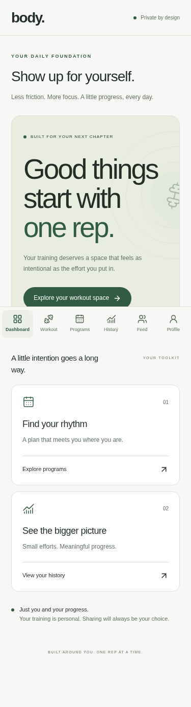
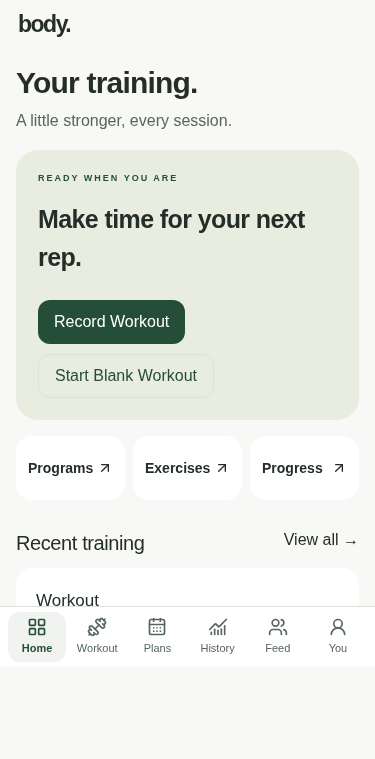
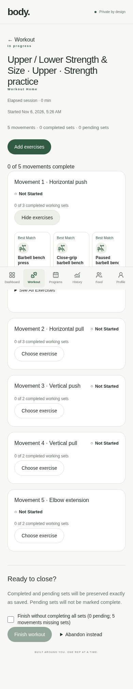
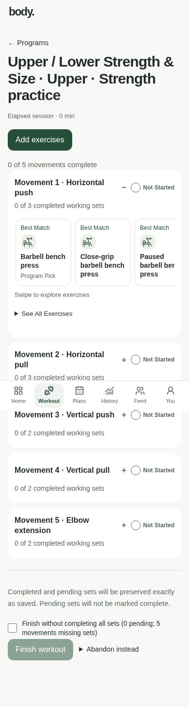
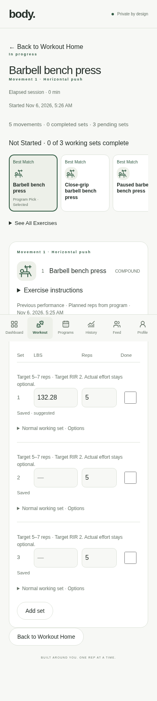
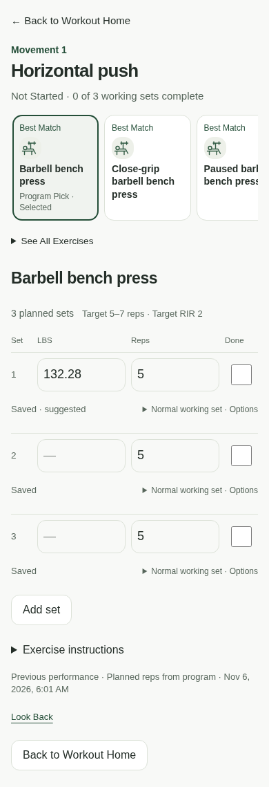
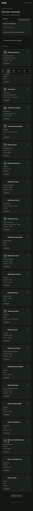
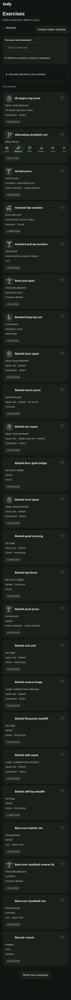

# Mobile-first application UX

This refinement starts from merged Phase 7.3 PR #17 (`abb01c8`). It preserves the existing Next.js/Supabase/Workers stack, the two-screen workout architecture and server-authoritative performance. The supplied brief defines the visual direction; the two referenced mockup image files were not attached.

## Audit and design decisions

The previous home was a large marketing hero and still said logging was coming soon. Shared pages repeated slogans, eyebrow labels and large heading gaps. Exercise/library cards and program details required substantial scrolling. Workout Home repeated metadata and actions, while the focused logger still showed global tabs and workout-level information. Settings used large detached sections and analytics stacked explanatory text and full tables.

The application now uses a shared `src/app/app-ux.css` presentation layer, native system fonts, consistent rounded surfaces, restrained green, 44–48 px practical controls and readable field text. Existing Tailwind/shadcn primitives are refined rather than replaced. The compact six-tab shell preserves existing destinations, with short visual labels and original accessible names. Safe areas remain explicit. Actual focused-log screens hide the mobile global bar; Back always leads to Workout Home. Home and logger now share one Back | Timer | End Workout bar; see [focused workout mode](active-workout-mode.md).

Home prioritizes an actual active workout or Record/Start Blank, useful shortcuts and bounded recent completed history. It does not invent a scheduled next workout. Library, program cards/details, records, history, settings and authentication share the same density/type/surface rules. Program descriptions and workout prescriptions are disclosed explicitly; rest breaks are not numbered as workouts. Analytics retain all calculations and metrics, with calendar methodology and weekly tables disclosed on demand. No metrics are removed for appearance.

Workout Home uses compact expandable movement headers, accessible gray/orange/green status icons and text, one exercise carousel, and direct links to existing selected loggers. The focused screen shows movement intent, the compact selector, selected exercise, saved progress and the existing set engine. Instructions and existing illustrations remain optional. No video library is fabricated. The 180 ms entrance effect respects reduced motion. Focus changes occur before paint only on actual screen switches, never as a late initial hydration scroll.

## Optional ad-hoc focus

Record Workout opens a two-selection setup: Primary Muscle Group and optional Secondary Muscle Group. Start Blank Workout also remains a direct action from entry/Home/setup, with no questions. Primary/secondary duplicates are disabled/reset in the UI and rejected again by the server.

The pure `suggested-shell.ts` domain uses existing canonical muscle/pattern/type metadata. It chooses two distinct, complementary supported primary patterns per muscle, with stable priorities (for example flat/incline pressing for chest; elbow extension/close-grip pressing for triceps). One selected muscle normally yields two slots; two yield four. A smaller catalog produces fewer slots with an explicit explanation, never duplicated filler. Unsupported duration/assistance and misleading `other` classifications are excluded. Custom, properly classified supported exercises can contribute availability.

Default intent is three working sets, 8–12 reps for compound patterns and 10–15 for isolation. This is editable session guidance, not personalized coaching, automatic progression, a seeded program or actual performance. No exercise, weight, effort or completion is preselected. Users pick actual exercises from the same in-workout carousel and use exact-exercise history only. Actual RPE/RIR/failure remain independently reported.

During an ad-hoc workout users may add supported movement intents, remove untouched ones, or change them. Recorded/edited movements cannot be removed or relabeled. A confirmed change preserves the old movement and performance and appends a new intent. Unknown network outcomes retain retry identity; retries do not duplicate slots. Removed intent cannot receive new selections. Consumer movement titles omit numbering without rewriting persisted identifiers/order.

## Data and security

The forward migration `20261106052342_ad_hoc_movement_shells.sql` extends existing `workout_movements` and sessions; it creates no competing backend, program template or actual logging system. New caller inputs have narrow INSERT grants, immutable server-derived snapshots, validated taxonomy and defaults. The only movement UPDATE input is removal time, guarded to reject programme changes, recorded-work removal, foreign owners and closed/expired parents. Hard deletion and snapshot/ownership writes remain denied.

Invoker start/edit RPCs verify `auth.uid()`, use parent/profile locks, payload-checked owner-scoped nonces, and preserve committed expiry cleanup through NULL rejection. Actual selection, set CAS/mutation IDs, queue/drafts, canonical weight precision, ownership RLS, history and records remain on existing operations. The completion rule now recognizes unselected ad-hoc intent and excludes removed intent. Explicit movement edits use the existing activity transport; passive rendering/navigation never creates training evidence.

The model and SQL APIs remain usable by future native clients. Presentation, deterministic suggestion rules and authoritative persistence remain separate. No Swift app or WebView wrapper is introduced.

## Validation and release

Runtime/browser checks use disposable local Supabase and synthetic accounts only. No hosted SQL, migrations, deployment or merge is performed.

| Check                                                    | Result                                                          |
| -------------------------------------------------------- | --------------------------------------------------------------- |
| Fresh local migration replay                             | Pass                                                            |
| Database lint                                            | Pass, no warnings                                               |
| pgTAP                                                    | 1,724 assertions across 15 files passed                         |
| ESLint and strict TypeScript                             | Pass                                                            |
| Vitest                                                   | 193 tests across 42 files passed                                |
| Formatting and diff whitespace                           | Pass                                                            |
| Catalog consistency                                      | 183 exercises; 12 programs, 46 days, 205 slots passed           |
| Next.js production build                                 | Pass                                                            |
| Cloudflare/OpenNext build and Wrangler no-upload dry-run | Pass                                                            |
| Full Next.js desktop/mobile browser suite                | 86 passed; 10 intentional duplicate visual-matrix cases skipped |
| Full local Workers desktop/mobile browser suite          | 86 passed; 10 intentional duplicate visual-matrix cases skipped |

The visual matrix covers five viewport sizes in both themes in the desktop test project; its ten duplicate mobile-project cases are intentionally skipped. Functional tests run in both desktop and mobile projects. New ad-hoc coverage checks single/two-muscle starts, duplicate rejection, limited patterns, blank starts, actual exercise selection, refresh, safe recorded-movement continuation and removal/addition. Existing ownership, concurrency, drafts, logging, duration, records and navigation regressions remain in the suites.

Review and apply the single forward migration through the existing approved mechanism before releasing this app revision. No new dependencies, environment keys or Worker bindings are required. Confirm the correct target/backup/recovery and automation settings before any hosted operation. Physical iOS/Safari, device text scaling and real safe-area rendering require device verification; Chromium viewport emulation is not a native-device claim.

## Before / after examples

These captures use synthetic local accounts and fixtures, not production users. Full viewport captures cover 375×667, 390×844, 430×932, tablet portrait (768×1024) and desktop (1440×900), in both themes. The following examples show the same representative screens and fixture context; capture timestamps differ.

| Screen                                  | Before                                                           | After                                                          |
| --------------------------------------- | ---------------------------------------------------------------- | -------------------------------------------------------------- |
| Home, 375px light                       |             |             |
| Workout Home with selector, 390px light |  |  |
| Focused logger, 390px light             |     |     |
| Exercise library, 430px dark            |   |   |

The movement-first correction replaces the initial canonical-muscle/two-pattern setup with broad primary/optional secondary focus and catalog-supported emphasis. See [current quick-workout recipes and persistence](movement-matching-smart-workouts.md). The two-screen workout architecture and manual ad-hoc editing remain intact.
