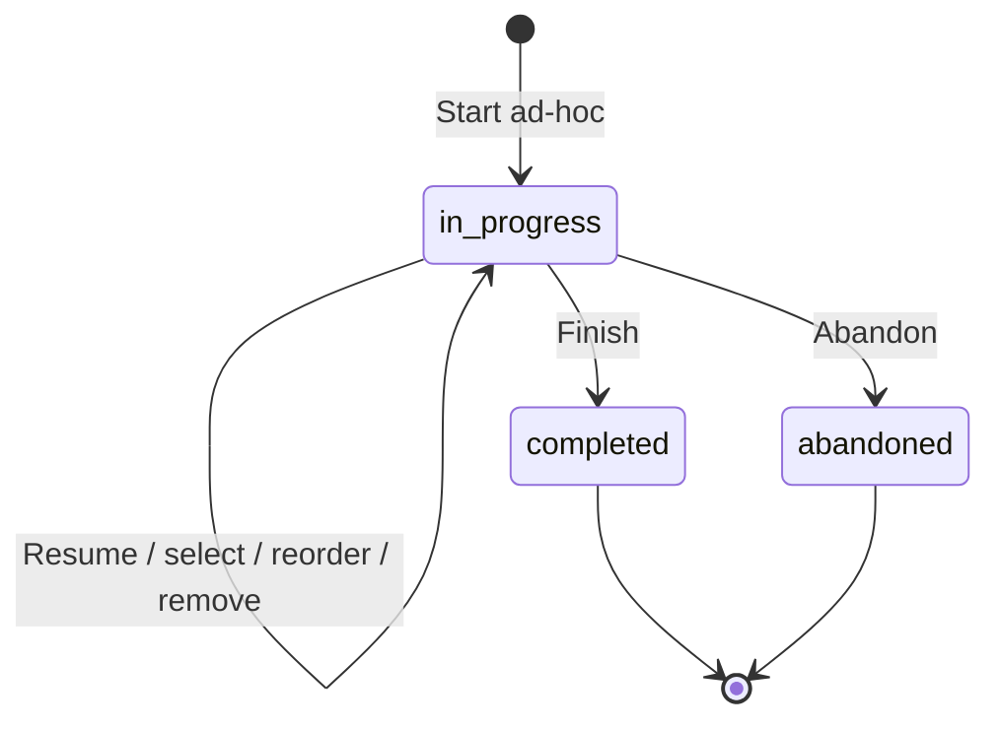

# Workout session lifecycle — Phase 5.1

Workouts now support ad-hoc start, resume, exercise selection, reordering/removal, finish and abandon. The existing Supabase Auth, protected shell, exercise classifications and deterministic recommendation service remain in place. No sets, weights, reps, PR calculations, program generator, OAuth, social or trainer features are added.

## Flow and state

`/workout` finds the owner's one active session and offers **Resume workout**, otherwise **Start workout**. Starting calls the transactional database operation and redirects to `/workout/<id>`; it never creates a second active session silently. A current session remains available across refresh, revisit and devices because PostgreSQL stores its state.

The detail page shows status, UTC start/close timestamps and ordered saved exercise snapshots. **Add exercises** opens `/workout/<id>/select` using the existing selector, combined filters, exercise types and thumbnails. One tap adds an exercise; selected candidates are disabled, recommendations exclude their IDs, and **Done** returns to the workout. Reordering uses accessible up/down buttons. There are no new modals. Abandon requires deliberately expanding its action section. Loading, retry/error and empty states remain within the existing shell.



Finish/abandon returns to `/workout` with a success message. Saved closed session URLs remain readable but offer no selection editing. The same terminal operation can be retried idempotently without changing its timestamp; conflicting terminal transitions and reopening are rejected. Starting again after closing creates a new session.

A completed **session** does not prove completed sets. The forward migration permits `status='completed', completion_status='none'` so an empty or selection-only workout can finish honestly. No set records are generated. If existing data contains completed sets, closing preserves them and reports `partial`, never guesses full prescription completion. Phase 5.2 must define real logging/completion behavior. UTC is labeled explicitly; user-timezone preferences and a live elapsed timer are future work.

## Data, ownership and concurrency

Migration: `20261103220312_workout_session_lifecycle.sql`. It changes existing tables only:

- A partial unique index on `workout_sessions(owner_id)` for `in_progress` enforces one active workout across ad-hoc and future program starts.
- `workout_exercises.removed_at` supports non-destructive removal. Clients receive a narrow UPDATE grant, not INSERT of this field and not hard DELETE.
- The existing session/position unique constraint becomes deferrable, allowing atomic adjacent swaps without temporary collisions. Composite owner/parent keys and other history constraints remain intact.
- Completion consistency permits a finished session with no recorded sets. Allowed status strings are unchanged.
- Private invoker triggers guard terminal transitions, removal eligibility, removed-parent set insertion and direct authenticated selection writes after closure.

**Existing duplicate active sessions cause the migration to fail before changes.** It does not pick a winner, merge sessions or auto-abandon user work. A reviewer must inspect the approved target and get explicit authorization for any resolution; do not repair or rewrite migration history to force deployment. Existing completed/abandoned records are not backfilled or modified.

Three authenticated-only **SECURITY INVOKER** functions with empty search paths implement transactional writes. Anonymous/service-role execution is not granted; ordinary underlying RLS and column privileges still apply. There are no owner parameters or privileged bypasses:

- `start_ad_hoc_workout()`: INSERT with conflict handling against the active index, then return the existing/new ID; bounded retry handles a concurrent close. New rows leave program attribution empty.
- `edit_workout(session, operation, exercise, item, direction)`: lock the verified owner's session, require it active, validate visible/nonarchived source exercises, snapshot names/instructions, return an existing nonremoved selection on duplicate add, or swap adjacent active positions. Missing neighbors are harmless no-ops. A workout is bounded to 100 nonremoved selections. Position gaps and removed rows are allowed; the UI numbers the visible ordered list rather than exposing storage gaps.
- `end_workout(session, outcome)`: lock the owned session, validate the transition, preserve any actual set data and assign the database close timestamp atomically.

Server Actions verify identity with `getUser()` before calling these functions, validate UUIDs/operations/directions and never trust submitted owner IDs. Safe error messages offer retry without exposing database details. Each loader verifies identity independently, scopes queries to the owner and uses the existing no-store server client. Workout source joins explicitly choose `exercise_id`, not the separate prescribed-exercise relationship.

RPC mutations acquire the session lock before editing selections. This serializes concurrent start/add/remove/reorder/finish actions; the unique index also protects direct session inserts. A set-insert trigger takes the parent lock and rejects removed selections, so removal and future logging cannot race into hidden recorded sets. Direct authenticated appends/reorders/source changes are guarded against closed sessions. Privileged historical fixture/import inserts remain possible; existing owner note/status correction grants outside the new lifecycle are not globally revoked. Future clients should use the RPCs and the same lock ordering rather than write multi-step selections directly.

## Removal and history

Only an active session's `pending` selection with **no set rows at all** may be removed. Removal marks a timestamp and hides that entry; its ID, exercise reference and snapshots survive. An identical retry succeeds. A later re-add uses a new selection ID, preserving the removed tombstone. Any recorded/prescribed set row conservatively protects the parent from this removal flow. There is no new cascading DELETE permission.

Library recents exclude removed selections. Remaining selection rows can indicate familiarity, including in-progress or abandoned selections, but never stand in for completed reps. Catalog archiving does not erase a workout selection; it retains its snapshot and can still resolve family art from the RLS-visible archived source. Future history screens must account for `removed_at` rather than treating tombstones as performed exercises.

## Architecture and future phases

- `src/features/workouts`: strict DTOs, state/ordering helpers, server queries and actions.
- `src/components/workouts`: minimal action forms and selector integration.
- `src/app/(app)/workout`: entry, detail, selection, loading and error routes.
- Existing exercise selector gains selected IDs/pending controls; its classification and recommendation logic is reused.

Set logging can attach to retained `workout_exercises.id` through the existing `workout_sets` table in Phase 5.2. Program start should materialize the existing attribution/snapshot fields transactionally while reusing the single-active rule; no program cursor advancement is implemented now. Trainer/native clients can use the same authenticated contracts once separately authorized and tested. Rich media remains behind the visual resolver.

## Local validation and deployment

Use the disposable Supabase/Auth/Mailpit setup and public variables from [authentication.md](authentication.md). Follow the documented Docker proxy health-probe workaround only if needed. Never run tests against hosted production.

```sh
npm run db:reset
npm run db:lint
npm run db:test
npm run catalog:check
npm run lint
npm run typecheck
npm test
npm run format:check
npm run build
npm run cf:build
npm run cf:check
node --env-file=.env.local node_modules/@playwright/test/cli.js test
```

The env file must point to loopback local Supabase and app origins; test helpers reject hosted targets. Tests cover state transitions, resolver fallback/errors, ordering, safe actions, active uniqueness, actual concurrent RPC starts, owner/system visibility, duplicate selection, logged-record protection, terminal-state guards, snapshot preservation and real desktop/mobile flows. Database fixtures roll back. Browser tests use synthetic local accounts and retain no production data.

Manual smoke test: start → add two exercises → refresh → move/remove → return to Workout → resume → finish; start again → abandon. Check custom/archived source visibility, thumbnail fallback, keyboard controls, mobile layout and both themes. Finishing must leave actual set count unchanged.

Phase 3.1 and Phase 4.1 are confirmed merged into fetched GitHub main (`fcaddb8`); this branch adds only the Phase 5.1 change on top of their shared history. Before any approved delivery, verify the intended project, earlier migration history, active-session uniqueness, backups/PITR, forward recovery and the single native migration integration. Apply the reviewed migration before serving this application version; confirm new function ACLs and owner isolation afterward. No extra environment keys, Workers bindings or deployment scripts are needed. No hosted SQL, remote migration or production deployment is part of this phase. Publication relies on the user's earlier repository-wide confirmation that Supabase Automatic branching is disabled, not an independent live dashboard inspection.

## Validation record — 2026-11-03

- Fresh local replay of all five migrations and local database lint passed.
- pgTAP: **1,130 tests passed** across four suites; Vitest: **88 tests passed** across 17 files.
- ESLint, strict typecheck, Prettier and catalog consistency passed.
- Standard production build, OpenNext Workers build and Wrangler dry-run passed; nothing was uploaded or deployed.
- **26 desktop/mobile Playwright tests passed on Next.js and 26 on local Workers**, including concurrent starts, complete selection lifecycle, owner isolation, real Auth and image loading. Independent runs use separate `--output` directories to avoid artifact cleanup collisions.
- Mobile light/dark workout screens and the desktop selector were visually reviewed against the local Worker.

The first browser attempt encountered local Auth restart readiness after reset; health and synthetic signup were verified before rerunning. Query validation caught and corrected the selected-versus-prescribed exercise join. No local functional test remains blocked. Hosted database history/security settings, real SMTP, production deployment and physical-device behavior were not inspected/tested. The known Docker proxy health-probe and local `Request.cf` fallback limitations remain documented in the infrastructure/authentication guides.

## Phase 5.2 extension

See [set logging](set-logging.md) for the forward migration, active-only set write guards, load modes, server revisions, idempotent invoker operations and updated none/partial/full completion rules. The earlier phase descriptions above are historical. Closed set edits/deletion are now denied to ordinary clients; a future explicit correction workflow is required. Prior migrations remain immutable.

## Phase 5.3 extension

See [smart defaults](smart-set-defaults.md) for the additive provenance/entry metadata, authenticated history/initialization services, automatic pending templates and untouched-selection removal rules. Existing actual performance and account units are not backfilled. Prior migrations remain immutable.
